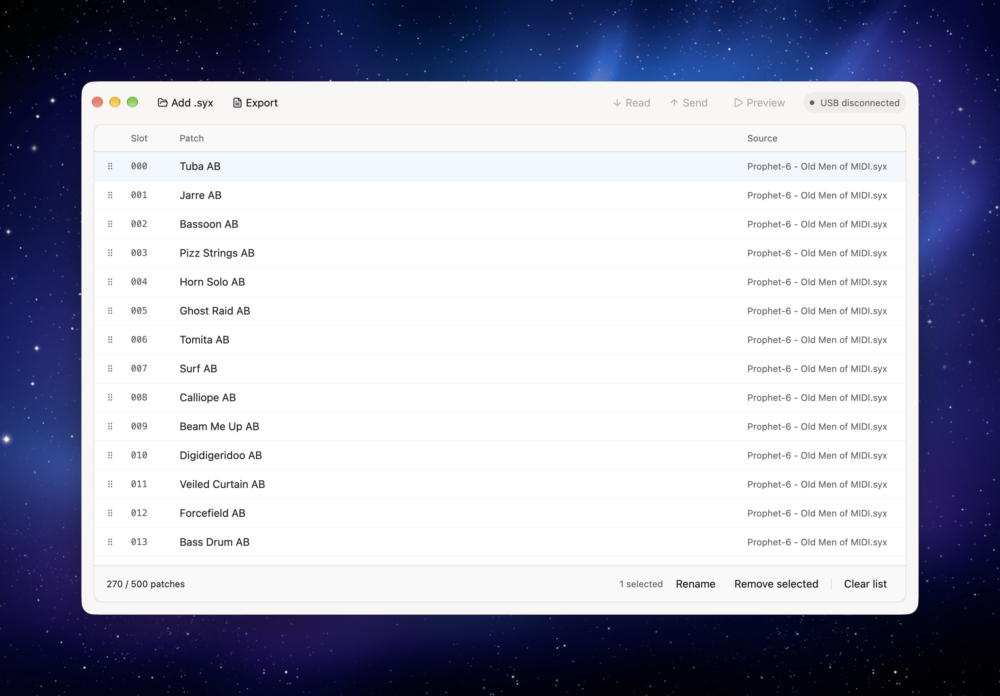

# Prophet-6 Patch Librarian

The [Sequential Prophet-6](https://sequential.com/product/prophet-6/) is a six-voice analog synthesizer inspired by the Prophet-5. Patch Librarian is a macOS and Linux app for organizing the sounds you play on it. Back up a bank over USB, combine patches from different `.syx` files, and put your favorites in the slots where you want them.

## Download

- [**macOS (Apple Silicon)**](https://github.com/spatie/prophet-6-patch-librarian/releases/latest/download/Prophet-6-Patch-Librarian-macOS-arm64.zip): Unzip the signed, notarized app, drag it to Applications, and open it.
- [**Linux (x86-64)**](https://github.com/spatie/prophet-6-patch-librarian/releases/latest/download/Prophet-6-Patch-Librarian-Linux-x86_64.tar.gz): Extract the archive and run `./prophet-6-patch-librarian` from the extracted folder. Built for Ubuntu 24.04. You’ll need a desktop with Vulkan support and access to the ALSA sequencer for USB MIDI.

See the [latest release](https://github.com/spatie/prophet-6-patch-librarian/releases/latest) for release notes and SHA-256 checksums.



## Organize patches

1. Click **Add .syx** or drop files onto the list. Each file adds its patches at the end. The **Source** column shows where each patch came from.
2. Drag patches to reorder them. Shift-click selects a range; Command-click toggles individual patches. Click a patch name to edit it in place, then press Return to save or Escape to cancel. Names can be up to 20 printable ASCII characters. Use **Remove selected** or Delete to take patches out of the list. **Clear list** asks before removing everything.
3. Click **Export** to save a `.syx` file to a folder you choose. With nothing selected, it saves the whole list. With a selection, it saves only those patches. Export numbers patches from `000` in list order.

Editing the list never writes to the synth or changes the original files. On macOS, if you close the window, click the Dock icon to bring back your working list. The list resets when you quit the app, so export it first if you want to keep it.

## Patch collections

Here are some great patches to try on your Prophet-6. Start with the factory sounds, or pick a few favorites from different packs and make a bank of your own. Unzip any archives first, then use **Add .syx** to bring the sounds into Patch Librarian.

- [Sequential Factory Presets](https://sequential.com/wp-content/uploads/2015/07/P6-Factory-Programs-ReadMe.zip). The 500 sounds that ship with the Prophet-6, straight from Sequential. A good starting point if you want to build a bank around sounds you already know.
- [Old Men of MIDI](https://sequential.com/wp-content/uploads/2015/09/Prophet6_OMOM_Sounds.zip). A 270-patch collaboration released by Sequential, with contributions from Jordan Rudess, John “Skippy” Lehmkuhl, and ten other sound designers. Try the organs, animated pads, or the more out-there arps and percussion.
- [Chords of Quebec](https://www.presetpatch.com/f/sequential-prophet-6/chords_of_quebec_syx). A single patch shared by Nolandelepine on Preset Patch. An easy one to drop into a bank you're already putting together.
- [The Sun God RA](https://www.presetpatch.com/f/sequential-prophet-6/prophet-6_-_the_sun_god_ra_bank_zip). A bank shared by the sun god RA on Preset Patch, designed with the Prophet-6's Vintage Mode switched on.

## Connect your Prophet-6

Connect it directly over USB and set **MIDI SysEx** to **USB** in the upper Globals menu (button 8). The app looks for one Prophet-6 MIDI input and output.

- **Preview** loads one selected patch temporarily. Press a key on the Prophet-6 to hear it. Preview replaces unsaved synth edits, but does not overwrite saved patches. Only this warning can be turned off.
- **Read** reads all 500 user slots and replaces the working list only after a complete read. Export the list immediately after reading to make a backup in the synth's current slot order.
- **Send** requires exactly 500 patches and always asks before replacing user slots `000–499` in list order. The app does not write to factory slots `500–999` or read back slots after sending.

Protocol reference: [Sequential Prophet-6 Operation Manual, Appendix C](https://sequential.com/wp-content/uploads/2021/02/Prophet-6-Operation-Manual-2.1.pdf).

## Build

The app is built in Rust with [GPUI Kit](https://gpui-kit.com/) and [midir](https://github.com/Boddlnagg/midir). Use a current stable Rust toolchain. On macOS, install Xcode and its command-line tools. On Ubuntu, install `libasound2-dev libfontconfig1-dev libxcb1-dev libxkbcommon-dev libxkbcommon-x11-dev`.

```sh
cargo test --locked
cargo run --locked
```

Run `bash scripts/package-macos.sh` for a local Mac app or `bash scripts/package-linux.sh` for a Linux tarball.

### Cut a release

1. Update the app version in `Cargo.toml` and refresh `Cargo.lock` with `cargo check`. Push the change to `main` and wait for the [build workflow](https://github.com/spatie/prophet-6-patch-librarian/actions/workflows/build.yml) to pass on both platforms. Download the Linux archive from that run. The Mac artifact in Actions is for local testing only.
2. On an Apple Silicon Mac, check out the same commit. Set `CODESIGN_IDENTITY` to the Developer ID Application identity and `NOTARY_PROFILE` to the `notarytool` profile in Keychain, then run `bash scripts/notarize-macos.sh`. Use the final ZIP it prints a checksum for, not `notary-submission.zip`.
3. Create a GitHub release with a tag matching the app version (for example `v1.0.1`), targeting that commit. Upload the notarized Mac ZIP, Linux tarball, and `SHA256SUMS` with both hashes. Keep the asset names unchanged so the download links above always point to the latest version.

## Contributing

Please see Spatie's [contribution guide](https://github.com/spatie/.github/blob/main/CONTRIBUTING.md) for how to open issues and pull requests. For this Rust app, run `cargo fmt --all --check` and `cargo test --locked` before opening a pull request.

## Code of Conduct

Please read our [Code of Conduct](CODE_OF_CONDUCT.md) before participating.

## About Spatie

Spatie is a web development agency based in Antwerp, Belgium. You'll find an overview of our open source projects [on our website](https://spatie.be/open-source).

## Support us

If you find Patch Librarian useful, you can support our open source work by [buying one of our paid products](https://spatie.be/open-source/support-us).

## Postcardware

You're free to use the app. If it earns a spot next to your Prophet-6, we'd love a postcard from your hometown. You'll find our address on [our contact page](https://spatie.be/about-us) and the cards we've received on [our postcard wall](https://spatie.be/open-source/postcards).

## License

The app is licensed under the [MIT License](LICENSE.md). The patch collections linked above are separate downloads from their respective publishers.
