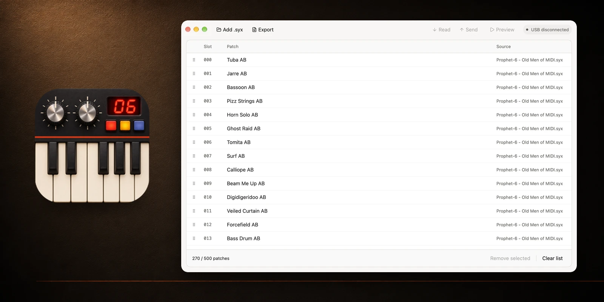

[](assets/patch-list.jpg)

# Prophet-6 Patch Librarian

The [Sequential Prophet-6](https://sequential.com/product/prophet-6/) is a six-voice analog synthesizer inspired by the Prophet-5. Patch Librarian is a macOS and Linux app for organizing the sounds you play on it. Back up a bank over USB, combine patches from different `.syx` files, and put your favorites in the slots where you want them.

## Download

- [**macOS (Apple Silicon)**](https://github.com/spatie/prophet-6-patch-librarian/releases/latest/download/Prophet-6-Patch-Librarian-macOS-arm64.zip): Unzip the signed, notarized app, drag it to Applications, and open it.
- [**Linux (x86-64)**](https://github.com/spatie/prophet-6-patch-librarian/releases/latest/download/Prophet-6-Patch-Librarian-Linux-x86_64.tar.gz): Extract the archive and run `./prophet-6-patch-librarian` from the extracted folder. Built for Ubuntu 24.04. You’ll need a desktop with Vulkan support and access to the ALSA sequencer for USB MIDI.

See the [latest release](https://github.com/spatie/prophet-6-patch-librarian/releases/latest) for release notes and SHA-256 checksums.

## About Spatie

Spatie is a web development agency based in Antwerp, Belgium. You'll find an overview of our open source projects [on our website](https://spatie.be/open-source).

## Support us

[](https://spatie.be/github-ad-click/prophet-6-patch-librarian)

If you find Patch Librarian useful, you can support our open source work by [buying one of our paid products](https://spatie.be/open-source/support-us).

## Postcardware

You're free to use the app. If it earns a spot next to your Prophet-6, we'd love a postcard from your hometown. You'll find our address on [our contact page](https://spatie.be/about-us) and the cards we've received on [our postcard wall](https://spatie.be/open-source/postcards).

## Usage

You don't have to plug in the synth to get started. Drop a couple of `.syx` files onto the list or click **Add .syx**. Each file adds its patches to the end, and the **Source** column tells you which pack each patch came from. Drag your favorites into the order you want. Shift-click to select a range, or hold Command on macOS (Ctrl on Linux) to pick patches one at a time.

To rename a patch, click its name and press Return when you're happy with it. Escape cancels the edit. The Prophet-6 has room for 20 printable ASCII characters per name. Use **Remove selected** to take patches out of the list, or **Clear list** to start over. None of this touches the original files or the patches on your synth.

When you've got a list you like, click **Export**. It saves the selected patches, or the whole list if nothing is selected, as a `.syx` file. The exported slots start at `000` and follow the list order. On a Mac, closing the window keeps your list around: just click the Dock icon to bring it back. Quitting clears it, so export anything you want to keep first.

When you're ready to plug in the Prophet-6, connect it directly over USB. On the synth, open the upper Globals menu and set **MIDI SysEx** (button 8) to **USB**. Here's what I'd do next:

- **Back up what's already on the synth.** Click **Read** to pull in all 500 user slots, then export the whole list before rearranging it. If you're already working on a list, export that first: a successful read replaces it.
- **Try a sound before committing to it.** Select one patch, click **Preview**, and play a few notes on the Prophet-6. This won't overwrite a saved patch, but it will replace any unsaved edits on the synth.
- **Send the bank when you're happy with it.** You'll need exactly 500 patches. **Send** asks before replacing user slots `000–499` in list order. It leaves factory slots `500–999` alone and doesn't read the user slots back to verify the write.

For the MIDI details, see [Appendix C of the Prophet-6 manual](https://sequential.com/wp-content/uploads/2021/02/Prophet-6-Operation-Manual-2.1.pdf).

## Patch collections

Here are some great patches to try on your Prophet-6. Start with the factory sounds, or pick a few favorites from different packs and make a bank of your own. Unzip any archives first, then use **Add .syx** to bring the sounds into Patch Librarian.

- [Sequential Factory Presets](https://sequential.com/wp-content/uploads/2015/07/P6-Factory-Programs-ReadMe.zip). The 500 sounds that ship with the Prophet-6, straight from Sequential. A good starting point if you want to build a bank around sounds you already know.
- [Old Men of MIDI](https://sequential.com/wp-content/uploads/2015/09/Prophet6_OMOM_Sounds.zip). A 270-patch collaboration released by Sequential, with contributions from Jordan Rudess, John “Skippy” Lehmkuhl, and ten other sound designers. Try the organs, animated pads, or the more out-there arps and percussion.
- [Chords of Quebec](https://www.presetpatch.com/f/sequential-prophet-6/chords_of_quebec_syx). A single patch shared by Nolandelepine on Preset Patch. An easy one to drop into a bank you're already putting together.
- [The Sun God RA](https://www.presetpatch.com/f/sequential-prophet-6/prophet-6_-_the_sun_god_ra_bank_zip). A bank shared by the sun god RA on Preset Patch, designed with the Prophet-6's Vintage Mode switched on.

## Build

The app is built in Rust with [GPUI Kit](https://gpui-kit.com/) and [midir](https://github.com/Boddlnagg/midir). Use a current stable Rust toolchain. On macOS, install Xcode and its command-line tools. On Ubuntu, install `libasound2-dev libfontconfig1-dev libxcb1-dev libxkbcommon-dev libxkbcommon-x11-dev`.

```sh
cargo test --locked
cargo run --locked
```

Run `bash scripts/package-macos.sh` for a local Mac app or `bash scripts/package-linux.sh` for a Linux tarball.

### Cut a release

1. Update the app version in `Cargo.toml` and refresh `Cargo.lock` with `cargo check`. Push the change to `main` and wait for the [build workflow](https://github.com/spatie/prophet-6-patch-librarian/actions/workflows/build.yml) to pass on both platforms. Download the Linux archive from that run. The Mac artifact in Actions is for local testing only.
2. On an Apple Silicon Mac, check out the same commit. Set `CODESIGN_IDENTITY` to the Developer ID Application identity and `NOTARY_PROFILE` to the `notarytool` profile in Keychain, then run `bash scripts/notarize-macos.sh`. Use the final ZIP it prints a checksum for, not `notary-submission.zip`.
3. Create a GitHub release with a tag matching the app version (for example `v1.0.1`), targeting that commit. Upload the notarized Mac ZIP, Linux tarball, and `SHA256SUMS` with both hashes. Keep the asset names unchanged so the download links above always point to the latest version.

## Contributing

Please see Spatie's [contribution guide](https://github.com/spatie/.github/blob/main/CONTRIBUTING.md) for how to open issues and pull requests. For this Rust app, run `cargo fmt --all --check` and `cargo test --locked` before opening a pull request.

## Code of Conduct

Please read our [Code of Conduct](CODE_OF_CONDUCT.md) before participating.

## License

The app is licensed under the [MIT License](LICENSE.md). The patch collections linked above are separate downloads from their respective publishers.
