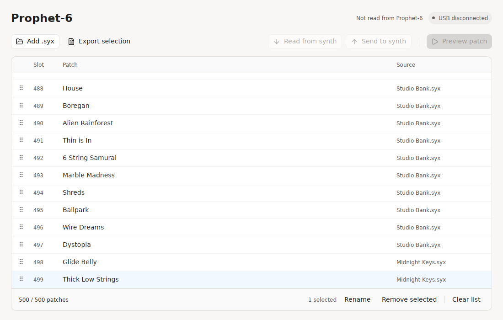

# Prophet-6 Patch Librarian

Prophet-6 Patch Librarian is a Mac app for the Sequential Prophet-6. Back up a bank over USB, combine patches from different `.syx` files, and put your favorites in the slots where you want them.



## Organize patches

1. Click **Add .syx** or drop files onto the list. Each file adds its patches at the end. The **Source** column shows where each patch came from.
2. Drag patches to reorder them. Shift-click selects a range; Command-click toggles individual patches. Select one patch and click **Rename** to edit its name (up to 20 printable ASCII characters). Use **Remove selected** or Delete to take patches out of the list. **Clear list** asks before removing everything.
3. **Export list** saves a `.syx` file to a folder you choose. If patches are selected, **Export selection** saves just those patches. Export numbers patches from `000` in list order.

Editing the list never writes to the synth or changes the original files. The working list starts empty when you reopen the app, so export it before quitting if you want to keep it.

## Connect your Prophet-6

Connect it directly over USB and set **MIDI SysEx** to **USB** in the upper Globals menu (button 8). The app looks for one Prophet-6 MIDI input and output.

- **Preview patch** loads one selected patch temporarily. Press a key on the Prophet-6 to hear it. Preview replaces unsaved synth edits, but does not overwrite saved patches. Only this warning can be turned off.
- **Read from synth** reads all 500 user slots and replaces the working list only after a complete read. Export the list immediately after reading to make a backup in the synth's current slot order.
- **Send to synth** requires exactly 500 patches and always asks before replacing user slots `000–499` in list order. The app does not write to factory slots `500–999` or read back slots after sending.

Protocol reference: [Sequential Prophet-6 Operation Manual, Appendix C](https://sequential.com/wp-content/uploads/2021/02/Prophet-6-Operation-Manual-2.1.pdf).

## Build

The app is built in Rust with [GPUI Kit](https://gpui-kit.com/) and [midir](https://github.com/Boddlnagg/midir). Use a current stable Rust toolchain and install Xcode and its command-line tools.

```sh
cargo test --locked
cargo run --locked
bash scripts/package-macos.sh
```

The packaging script creates `target/macos/Prophet-6 Patch Librarian.app`. By default it is ad hoc signed for local testing. Set `CODESIGN_IDENTITY` to a Developer ID Application identity available in your Mac's keychain for distribution signing. Notarization is separate.
